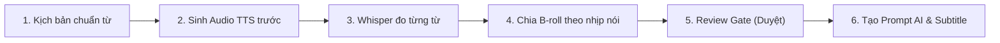

# 📖 Hướng Dẫn Sử Dụng Video Director Từ A–Z (Audio-First Production)

Chào mừng bạn đến với **Video Director Skill** — giải pháp sản xuất video YouTube Faceless bán tự động dành cho Antigravity Agent. 

Tài liệu này hướng dẫn bạn quy trình hoàn chỉnh từ lúc chưa có gì đến khi xuất xưởng trọn bộ asset của một video, lấy ví dụ thực chiến từ kênh **"Tiền Thực Chiến"**.

---

## 💡 Triết lý Audio-First: Tại sao khác biệt?

Thông thường, mọi người thường viết kịch bản → tạo hình ảnh/video AI → rồi mới chèn giọng đọc. Cách này thường gây ra các lỗi:
- Hình ảnh chạy hết mà giọng đọc chưa dứt, buộc phải kéo giãn clip hoặc lặp clip gây xấu video.
- Một đoạn nói dài 15 giây nhưng chỉ có 1 hình ảnh tĩnh khiến người xem buồn ngủ, tỉ lệ giữ chân (retention) tụt dốc.
- Phụ đề bị lệch nhịp, không khớp miệng hoặc mất hiệu ứng karaoke.

**Quy trình Audio-First đảo ngược hoàn toàn:**

> **Nguyên tắc cốt lõi**: Tạo giọng đọc chuẩn trước → Đo chính xác từng từ bắt đầu/kết thúc ở giây thứ mấy → Phân bổ nhiều B-roll chuyển cảnh linh hoạt cho 1 đoạn audio → Sinh phụ đề karaoke khớp 100% từng milli-giây.

---

## 🛠️ Bước 0: Khởi động & Kiểm tra sức khỏe hệ thống

Trước khi bắt đầu, hãy đảm bảo hệ thống âm thanh AI (VieNeu-TTS) đã sẵn sàng. Bạn không cần mở terminal, chỉ cần trò chuyện với Agent trong khung chat:

### 1. Kiểm tra trạng thái
Gõ vào chat:
```text
@health
```
**Agent sẽ phản hồi:**
```text
🏥 Video Director — Health Check
   Hệ điều hành: Windows AMD64 | Python: 3.12.10
   ✅ VieNeu-TTS API (http://localhost:8000)   HTTP 200
   ✅ VieNeu-TTS UI (http://localhost:7860)    HTTP 200
   ✅ Studio Dashboard (http://localhost:3000) HTTP 200
   ✅ Whisper (timing analysis)                openai-whisper (sẵn sàng)
   ✅ VieNeu-TTS Model Cache                   models--pnnbao-ump--VieNeu-TTS-v3-Turbo

🚀 Hệ thống hoàn toàn sẵn sàng để tạo video Audio-First!
```

### 2. Nếu VieNeu-TTS chưa bật
Gõ vào chat:
```text
@start-tts
```
Agent sẽ tự động gọi launcher chạy dịch vụ nền cho bạn.

---

## 🏢 Bước 1: Khởi tạo kênh từ Channel Bible

Mỗi kênh YouTube faceless cần một bản "Hiến pháp" (Channel Bible) quy định: đối tượng khán giả, persona giọng đọc, bảng màu, phong cách visual (Style Lock), và danh sách điều cấm (Negative List).

### Thao tác:
Gõ vào chat:
```text
@new-channel tien-thuc-chien
```
Sau đó bạn dán nội dung file Channel Bible vào hoặc kéo thả file `channel-bible.md` vào chat.

### Kết quả tự động:
Agent sẽ tự động thiết lập thư mục:
```text
channels/tien-thuc-chien/
├── channel-bible.md    ← Lưu toàn bộ nhận diện & Style Lock
├── config.json         ← Cấu hình giọng mặc định (Hải Đăng), nhịp độ (4 từ/s)
├── schedule.md         ← Lịch trình 7 video đầu tiên bám sát trụ nội dung
└── videos/             ← Nơi lưu trữ các video của kênh
```

Và xuất bảng lịch trình ban đầu:
```text
LỊCH TRÌNH — Tiền Thực Chiến
| # | Slug | Tiêu đề tạm | Trụ nội dung | Trạng thái |
|---|---|---|---|:---:|
| 1 | thoat-bay-no-the-tin-dung | Lương 12 Triệu Nhưng Nợ Thẻ 40 Triệu... | Cứu hộ tài chính | ⬜ |
| 2 | lam-phat-loi-song-luong-tang-tien-mat | Tại Sao Lương Tăng Gấp Đôi Vẫn Về 0? | Giải phẫu cạm bẫy | ⬜ |
...
```

---

## 🎬 Bước 2: Bắt đầu video mới & Tạo kịch bản

Ta bắt đầu làm video đầu tiên trong lịch trình: `thoat-bay-no-the-tin-dung`.

### 1. Khởi tạo video
Gõ vào chat:
```text
@new-video thoat-bay-no-the-tin-dung
```
*(Nếu nhập tiếng Việt có dấu như `@new-video "Lương 12 triệu nợ thẻ"`, Agent cũng tự động chuẩn hóa thành slug không dấu).*

### 2. Tạo kịch bản chuẩn thời lượng AI
Gõ vào chat:
```text
@gen-script "Lương 12 triệu nhưng nợ thẻ 40 triệu: Quy trình 4 bước cắt mỏ neo nợ nần" -minutes 10
```

### Cách Agent kiểm soát kịch bản:
Agent sẽ bám sát **Ràng buộc thời lượng AI Video**:
- Cảnh AI Video chỉ được phép có độ dài: **4 giây, 6 giây, 8 giây, hoặc 10 giây**.
- Trần số từ tiếng Việt:
  - Cảnh **4s**: Tối đa **12 từ**
  - Cảnh **6s**: Tối đa **18 từ**
  - Cảnh **8s**: Tối đa **24 từ**
  - Cảnh **10s**: Tối đa **29 từ**

**Ví dụ một đoạn kịch bản trong `script.md`:**
```markdown
## Scene 001
- Beat: Hook
- Loại dự kiến: AIV
- Duration dự kiến: 6s (15/18 từ)
- Narration: "Bạn nghĩ thẻ tín dụng là phao cứu sinh? Không, nó là cái mỏ neo kéo chìm bạn."

## Scene 002
- Beat: Bóc thực trạng
- Loại dự kiến: AIV
- Duration dự kiến: 4s (10/12 từ)
- Narration: "Mỗi tháng vừa nhận lương, số dư tài khoản đã lập tức về 0."
```

> **Chỉnh sửa kịch bản nếu cần**: Gõ `@edit-scene 1 "Nội dung lời đọc mới mà bạn muốn..."`.

---

## 🎙️ Bước 3: Sinh giọng đọc Audio (Audio-First)

Khi kịch bản đã ưng ý, ta tiến hành tạo audio cho từng scene trước:

### Thao tác:
Gõ vào chat:
```text
@gen-all-audio
```

### Cơ chế xử lý:
1. Agent gọi API VieNeu-TTS (`http://localhost:8000/v1/audio/speech`).
2. Tự động sử dụng giọng **"Hải Đăng"** (hoặc giọng bạn chỉ định qua `@set-voice`).
3. Xuất file âm thanh sạch vào:
   - `channels/tien-thuc-chien/videos/thoat-bay-no-the-tin-dung/audio/S001_narration.wav`
   - `channels/tien-thuc-chien/videos/thoat-bay-no-the-tin-dung/audio/S002_narration.wav`
   - ...

> **Nghe thử nhanh**: Gõ `@play 1` để nghe ngay audio cảnh 1.

---

## ⏱️ Bước 4: Đo đạc Timing bằng Whisper

Đây là bước then chốt của quy trình Audio-First. Whisper sẽ "lắng nghe" file audio thật và ghi lại chính xác từng từ xuất hiện ở thời điểm nào.

### Thao tác:
Gõ vào chat:
```text
@analyze --all
```

### Kết quả đầu ra:
Agent xuất file `S001_timing.json` chứa thông số chính xác:
```json
{
  "audio_file": "S001_narration.wav",
  "duration_ms": 5820,
  "word_count": 15,
  "words": [
    {"word": "Bạn", "start_ms": 120, "end_ms": 350},
    {"word": "nghĩ", "start_ms": 360, "end_ms": 550},
    {"word": "thẻ", "start_ms": 560, "end_ms": 780},
    {"word": "tín", "start_ms": 790, "end_ms": 1020},
    {"word": "dụng", "start_ms": 1030, "end_ms": 1350},
    ...
  ]
}
```
Nhờ đó, Agent biết chính xác: Cảnh 1 thực tế dài đúng **5.82 giây**.

---

## 🎨 Bước 5: Lên kế hoạch B-roll & Cổng duyệt (Review Gate)

Thay vì chỉ có 1 hình ảnh buồn tẻ cho một đoạn nói dài, Agent sẽ phân tích nội dung narration và timing để chia ra các **visual beats** phù hợp.

### 💰 Chiến lược Hybrid Asset (Tối ưu 70%–85% Credit):
Để tránh tốn quá nhiều credit video đắt đỏ:
- **30 giây đầu (Hook)**: Bắt buộc dùng **AIV (AI Video)** nhằm tối đa hóa tỷ lệ giữ chân người xem (retention) của YouTube.
- **Sau 30 giây (Thân bài & Lộ trình)**:
  - **GFX (Remotion/Hyperframe Motion Graphics — 0 Credit)**: Dành cho số liệu, công thức, biểu đồ tài sản, bảng so sánh đối lập... Tự động vẽ bằng code React/SVG.
  - **IMG (Ảnh tĩnh AI + Remotion Camera Motion)**: Sinh ảnh tĩnh từ Flux/Midjourney (chi phí rẻ hơn 10-20 lần) rồi chèn hiệu ứng camera chuyển động mượt mà (Ken Burns, Slow Zoom, Pan).
  - **AIV (AI Video)**: Chỉ giữ lại ở 1 cảnh cao trào bước ngoặt cảm xúc.

### 1. Yêu cầu lên kế hoạch B-roll
Gõ vào chat:
```text
@plan-broll
```

### 2. Xem bảng B-roll Plan
Gõ vào chat:
```text
@show-broll
```

**Bảng kế hoạch sẽ hiển thị:**
| Scene | Thời lượng Audio | B-roll ID | Thời lượng clip | Loại | Mô tả hình ảnh (Visual Beat) | Góc máy / Remotion |
|---|---|---|---|:---:|---|---|
| **S001** (0–6s) | 5.8s | `S001-A` | 6s | AIV | Nam thanh niên đứng nhìn hóa đơn thẻ đỏ rực, mặt biến sắc | CU, cận cảnh, push-in (Storyboard 3 khung) |
| **S002** (6–14s) | 8.4s | `S002-A` | 4s | AIV | Tin nhắn thông báo lương vừa ting ting vào tài khoản | MCU, ngang mắt |
| | | `S002-B` | 4s | AIV | Bàn tay vô hình rút sạch tiền đi, tài khoản về 0 | ECU, đặc tả bàn tay |
| **S003** (35–43s) | 8.0s | `S003-A` | 4s | GFX | Biểu đồ cột nợ thẻ tín dụng tăng vọt màu đỏ | Remotion: `ChartMotion` (0 credit) |
| | | `S003-B` | 4s | IMG | Bàn tay cắt đôi thẻ tín dụng màu vàng | Remotion: `KenBurns Zoom-in` |

> 💡 **Điểm ưu việt**: Đoạn Hook đầu dùng AIV chuyển động liên tục cuốn hút, nhưng đến phần phân tích số liệu sau 30s chuyển sang GFX code và ảnh tĩnh với camera motion, giúp video vừa sinh động vừa tiết kiệm hàng trăm credit AI!

### 3. Tùy chỉnh (nếu muốn)
- Muốn đổi thời lượng: `@edit-broll S001-A duration 4s`
- Muốn đổi sang ảnh tĩnh: `@edit-broll S002-B type IMG`
- Muốn đổi sang Remotion đồ họa: `@edit-broll S003-A type GFX`

### 4. Cổng duyệt (Bắt buộc)
Khi bạn đã hài lòng với phân bổ B-roll, gõ:
```text
@approve-broll
```
Agent sẽ khóa kế hoạch và cho phép bước tiếp theo được kích hoạt.

---

## 🚀 Bước 6: Tạo Asset Prompts, Khóa Style & Phụ đề Karaoke

Sau khi B-roll Plan đã được duyệt (`@approve-broll`), bạn bước vào giai đoạn chốt hình ảnh và phụ đề.

### 🎨 1. Cổng thử nghiệm phong cách — Style Prototyping Gate (Bắt buộc)
> ⚠️ **Vấn đề thực tế**: Đôi khi phong cách dự kiến trong lý thuyết (Channel Bible) khi đưa vào AI tạo hình (Google Flow / Midjourney / Flux) lại cho ra kết quả chưa đúng mong muốn. Nếu sinh hàng chục prompt ngay lập tức, bạn sẽ tốn công sửa lại toàn bộ!

Do đó, hệ thống trang bị cơ chế **Style Prototyping Gate**:
1. Gõ vào chat:
   ```text
   @test-style
   ```
2. Agent sẽ trích xuất đúng **1 prompt thử nghiệm** tiêu biểu nhất (cảnh Hook).
3. Bạn copy prompt này dán vào **Google Flow** (hoặc công cụ tạo ảnh của bạn) để render thử 1 hình.
4. **Đánh giá ảnh thực tế**:
   - Nếu chưa ưng ý: gõ `sửa style: <mô tả chi tiết hơn hoặc đổi tông màu...>`
   - Nếu ảnh thực tế đã đạt chuẩn đúng phong cách bạn muốn: gõ:
     ```text
     @lock-style
     ```
   - Agent sẽ khóa Style Lock đã kiểm chứng thực tế này vào cấu hình dự án!

---

### 📦 2. Sinh bảng Prompts hàng loạt (Sau khi Lock Style)
Sau khi đã `@lock-style`, bạn yên tâm yêu cầu Agent sinh toàn bộ prompt:
```text
@gen-prompts --all
```

**Agent sẽ tạo ra:**
- **Prompt ảnh Storyboard (`_sb.png`)**: Lưới 2 khung (cho clip 4s) hoặc 3 khung (cho clip 6s) để định hình chuyển động.
- **Prompt Video (`.mp4`)**: Mô tả chuyển động liên tục, câu lệnh cấm nhân vật mở miệng nói, và tự động gắn nguyên văn **STYLE LOCK** từ Channel Bible:
  ```text
  File: S001-A_6s_AIV.mp4
  Prompt: Use the attached storyboard image as the shot plan: animate panel 1 through panel 3 in order, with the timings below, as ONE continuous full-frame 6-second shot. 
  Audio: only natural ambient sound and scene sound effects; no music, no speech, no dialogue; characters never speak and keep their mouths closed.
  2D flat vector cartoon illustration, Vyond animation style, thick black outlines, vibrant and highly saturated solid colors. Flat shading, no complex lighting. White background. Expressive characters with exaggerated comic-style facial expressions...
  Avoid: Photorealism, 3D render, CGI, watercolor, text, extra fingers...
  ```

### 2. Sinh phụ đề Karaoke tự động
Gõ vào chat:
```text
@gen-subs
```
Agent sẽ tự động xuất file phụ đề:
- `subtitles/karaoke.srt` (chuẩn SRT tương thích CapCut, Premiere, DaVinci Resolve).
- Hoặc gõ `@gen-subs --format ass` nếu bạn muốn phụ đề đổi màu từng chữ như quán Karaoke!

### 3. Xuất cấu trúc Remotion / Hyperframe (Render tự động bằng Code)
Gõ vào chat:
```text
@gen-remotion
```
Agent sẽ tự động xuất file `assets/remotion-composition.json` chứa toàn bộ trình tự render tự động cho Remotion:
- Các phân đoạn `AIV`: ghép clip video tương ứng.
- Các phân đoạn `IMG`: tự động áp hiệu ứng Ken Burns chuyển động ảnh mượt mà.
- Các phân đoạn `GFX`: render trực tiếp component đồ họa React (`ChartMotion`, `CounterNumber`...) với 0 đồng chi phí credit!

### 4. Dựng hoạt ảnh và 3D với Hệ thống 20/20 Stack
Để tạo component đồ họa chuyển động cho cảnh GFX (như biểu đồ, số đếm, mô phỏng vật lý 3D):
- Xem toàn bộ 20 công cụ:
  ```text
  @list-motion-stack
  ```
- Tạo component hoạt ảnh cho cảnh:
  ```text
  @render-code-motion S003-A --stack motion
  ```
Agent sẽ áp dụng đúng công cụ trong bộ **20/20 Stack**:
- **3 Dựng Video**: Remotion Skills, Motion AI Kit, GSAP Skill.
- **Thiết kế**: SVGO (tối ưu icon SVG), Satori (HTML/JSX sang SVG).
- **Hoạt ảnh**: GSAP (timeline), Anime.js (stroke viền), Motion (UI React), Rive (state machine), Lottie (AE stickers).
- **Dựng 2D**: Remotion, Motion Canvas (giải thích toán học).
- **Dựng 3D**: Three.js, React Three Fiber, Drei, Rapier (vật lý rơi va chạm), Postprocessing (Bloom neon).
- **Âm thanh & Xuất video**: Howler.js (BGM ducking & SFX), Mediabunny, FFmpeg.

---

## ✂️ Bước 7: Dựng video (Assembly)

Bạn tải các file về và ráp theo checklist [`assembly-checklist.md`](file:///c:/Users/tuanlee/Downloads/audio/.agents/skills/video-director/references/assembly-checklist.md):

1. **Import Audio**: Kéo toàn bộ file `.wav` từ thư mục `audio/` vào Timeline phần mềm dựng (CapCut / Premiere).
2. **Import Subtitle**: Kéo file `karaoke.srt` đè lên track phụ đề (tự động khớp 100% không cần căn chỉnh tay).
3. **Import Asset hình ảnh**: Đặt các clip AIV và ảnh IMG vào đúng vị trí B-roll tương ứng theo danh sách.
4. **Nhạc nền & SFX**: Chèn nhạc nền nhẹ (nhỏ hơn giọng đọc -18dB) và các tiếng động theo gợi ý kịch bản.
5. **Xuất bản**: Gõ `@schedule done 1` để đánh dấu hoàn thành video 1 trong lịch trình.

---

## ⚡ Bảng tra cứu Cheatcode thường dùng

| Nhóm | Lệnh | Ý nghĩa |
|---|---|---|
| **Hệ thống** | `@health` | Kiểm tra tình trạng TTS, Whisper |
| | `@start-tts` | Khởi động VieNeu-TTS |
| | `@cheatsheet` | Mở danh sách tra cứu lệnh |
| **Kênh** | `@set-channel <tên>` | Chuyển sang làm việc với kênh khác |
| | `@status` | Xem video và kênh đang active |
| | `@set-voice "Hải Đăng"` | Đổi giọng đọc mặc định |
| **Video** | `@new-video <slug>` | Tạo thư mục video mới |
| | `@gen-script "<chủ đề>"` | Soạn kịch bản theo beat |
| | `@gen-all-audio` | Tạo toàn bộ audio giọng đọc |
| | `@analyze --all` | Whisper đo timing từng từ |
| | `@plan-broll` | Tính toán số B-roll cho video |
| | `@approve-broll` | **Duyệt B-roll** để sang bước sinh prompt |
| | `@test-style` | **Tạo thử 1 ảnh** trên Google Flow để kiểm tra phong cách thực tế |
| | `@lock-style` | **Khóa Style Lock** sau khi test ảnh thành công |
| | `@gen-prompts --all` | Xuất toàn bộ prompt ảnh/video đã chốt style |
| | `@render-code-motion`| Tạo component đồ họa chuyển động (20/20 Stack) |
| | `@list-motion-stack` | Xem 20/20 công nghệ dựng hoạt ảnh & video bằng code |
| | `@gen-subs` | Xuất file phụ đề karaoke `.srt` |
| | `@next` | Đi tiếp bước kế tiếp trong quy trình |
| | `@undo` | Quay lại bước trước đó |

---

## ❓ Câu hỏi thường gặp (FAQ & Troubleshooting)

**Q1: Nếu máy tôi không có GPU NVIDIA thì chạy được không?**
> **Trả lời**: Hoàn toàn được. VieNeu-TTS và Whisper đều tích hợp chế độ fallback tự động sang CPU (ONNX Runtime fp32) cực kỳ nhẹ và ổn định.

**Q2: Tại sao Agent từ chối tạo Prompts ngay sau khi có kịch bản?**
> **Trả lời**: Vì quy trình này là **Audio-First**. Bạn cần chạy `@gen-all-audio` → `@analyze` → `@plan-broll` → gõ `@approve-broll` thì Agent mới có số liệu timing chính xác để viết prompt.

**Q3: Tôi muốn sửa lại lời của một cảnh thì làm sao?**
> **Trả lời**: Bạn chỉ cần gõ `@edit-scene <số cảnh> "Lời đọc mới"`. Sau đó gõ `@gen-audio -scene <số cảnh>` để tạo lại riêng audio cho cảnh đó.

**Q4: Làm sao xuất tiêu đề và mô tả chuẩn SEO YouTube?**
> **Trả lời**: Chỉ cần gõ `seo` trong chat, Agent sẽ tự động xuất 3 tiêu đề giật tò mò, đoạn mô tả chuẩn SEO có hashtag, và 15 từ khóa từ Channel Bible.
