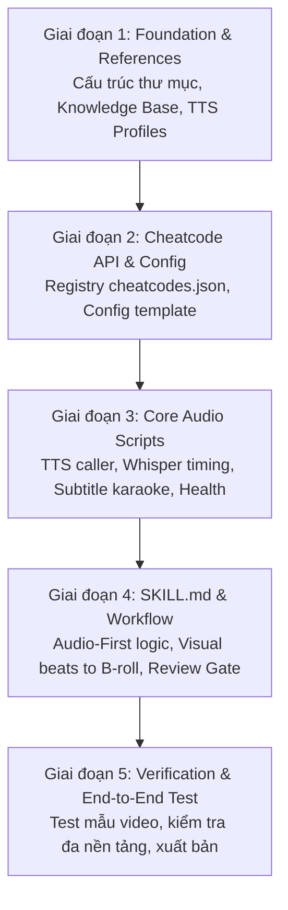

# 🗺️ Implementation Roadmap: Video Director Skill (Audio-First)

Tài liệu này xác định chi tiết **5 giai đoạn (Phases)** thực thi theo kế hoạch đã chốt tại [`docs/plan-video-director-skill.md`](file:///c:/Users/tuanlee/Downloads/audio/docs/plan-video-director-skill.md). Mỗi giai đoạn đều có danh sách công việc (Tasks), kết quả đầu ra (Deliverables), và tiêu chí nghiệm thu (Acceptance Criteria).

---

## 📊 Tổng quan tiến độ theo giai đoạn



---

## 🚀 Giai đoạn 1: Khung Skill & Tài liệu tham chiếu (Foundation & References)

**Mục tiêu**: Chuẩn bị đầy đủ nền móng thư mục trong repo `audio`, di chuyển và thích ứng toàn bộ tri thức từ `faceless-gem-notebooklm` sang dạng tham chiếu chuẩn cho Agent.

### Danh sách công việc (Tasks)
- [ ] **Task 1.1**: Khởi tạo cấu trúc thư mục skill:
  ```
  .agents/skills/video-director/
  ├── references/
  ├── scripts/
  └── resources/
  ```
- [ ] **Task 1.2**: Sao chép và chuyển đổi các tài liệu tham chiếu từ `03-knowledge/`:
  - `references/camera-vocabulary.md`: Bổ sung từ vựng góc máy, chuyển động, quy tắc nối cảnh.
  - `references/channel-bible.template.md`: Mẫu Channel Bible chuẩn cho mỗi kênh.
  - `references/shot-list.template.md`: Mẫu shot list theo format mới (bỏ tiền tố `V01_`).
  - `references/assembly-checklist.md`: Checklist ráp video hoàn chỉnh.
- [ ] **Task 1.3**: Soạn thảo `resources/tts-profiles.md`:
  - Đặt **VieNeu-TTS làm engine mặc định** (API localhost:8000).
  - Khai báo voice mặc định là **"Hải Đăng"** (có trong container của VieNeu-TTS) cùng danh sách preset fallback (`Binh`, `Tuyen`, `Vinh`, `Doan`, `Ly`, `Ngoc`).
  - Cấu hình cho `gemini-3.8` và `gemini-3.1` khi cần chuyển engine.
- [ ] **Task 1.4**: Tạo thư mục chứa các kênh: `channels/.gitkeep`.

### Đầu ra (Deliverables)
- 4 file markdown trong `references/`
- 1 file cấu hình TTS profile trong `resources/`
- Thư mục `channels/` sẵn sàng nhận dữ liệu dự án.

---

## ⚡ Giai đoạn 2: Cheatcode API Layer & Config System

**Mục tiêu**: Thiết lập hệ thống "cheatcode" thân thiện người dùng, cho phép user tương tác với Agent bằng các lệnh ngắn dạng `@command` mà không cần tiếp xúc terminal.

### Danh sách công việc (Tasks)
- [ ] **Task 2.1**: Xây dựng `resources/cheatcodes.json`:
  - Đăng ký đầy đủ 30+ cheatcodes thuộc 9 nhóm:
    1. **CONFIG**: `@set-voice`, `@set-channel`, `@set-pace`, `@set-tts`, `@set-style`, `@config`
    2. **PROJECT**: `@new-channel`, `@new-video`, `@status`, `@ls`
    3. **AUDIO**: `@gen-audio`, `@gen-all-audio`, `@play`
    4. **TIMING**: `@analyze`, `@timing`
    5. **B-ROLL**: `@plan-broll`, `@show-broll`, `@edit-broll`, `@approve-broll`
    6. **SUBTITLE**: `@gen-subs`, `@preview-subs`
    7. **ASSETS**: `@gen-prompts`, `@show-prompts`, `@shot-list`
    8. **SCRIPT**: `@gen-script`, `@show-script`, `@edit-scene`
    9. **HEALTH & PIPELINE**: `@health`, `@start-tts`, `@stop-tts`, `@pipeline`, `@next`, `@undo`, `@help`, `@cheatsheet`
- [ ] **Task 2.2**: Xây dựng template cấu hình `resources/config.json`:
  - Chứa các giá trị mặc định cho channel/video mới:
    - `active_channel`: `""`
    - `active_video`: `""`
    - `default_voice`: `"Hải Đăng"`
    - `default_pace`: `4` (từ/giây)
    - `tts_engine`: `"vieneu"`
    - `tts_api_url`: `"http://localhost:8000"`
    - `whisper_model`: `"base"`
    - `subtitle_format`: `"srt"`
    - `subtitle_group_size`: `4`
- [ ] **Task 2.3**: Thiết kế logic chuẩn hóa slug cho `@new-video <video-slug>`:
  - Tự động chuyển đổi tiếng Việt có dấu/khoảng trắng thành slug sạch (ví dụ: `"AI Thay Đổi Giáo Dục"` → `ai-thay-doi-giao-duc`).

### Đầu ra (Deliverables)
- `resources/cheatcodes.json` hoàn chỉnh
- `resources/config.json` template

---

## 🛠️ Giai đoạn 3: Core Audio Scripts (Audio-First Engine)

**Mục tiêu**: Viết các script xử lý tự động chạy đa nền tảng (Windows PowerShell & Linux Bash + Python), tự động phát hiện phần cứng và môi trường.

### Danh sách công việc (Tasks)
- [ ] **Task 3.1**: Script gọi TTS API:
  - `scripts/tts-generate.ps1` (Windows): Gọi OpenAI-compatible endpoint `/v1/audio/speech`, hỗ trợ chọn voice (`Hải Đăng`, v.v.), xuất file `.wav` cho scene.
  - `scripts/tts-generate.sh` (Linux/Ubuntu): Chức năng tương đương bằng cURL.
- [ ] **Task 3.2**: Script phân tích timing audio (`scripts/audio-analyze.py`):
  - Dùng thư viện `openai-whisper` hoặc `faster-whisper`.
  - Hỗ trợ chạy trên cả GPU (CUDA) và CPU fallback.
  - Xuất ra file JSON chuẩn với word-level timestamps (`start_ms`, `end_ms`).
- [ ] **Task 3.3**: Script sinh subtitle karaoke (`scripts/subtitle-gen.py`):
  - Đọc các file timing JSON trong thư mục video.
  - Gom từ theo cụm (`group_size: 4`) và đồng bộ chính xác theo milli-giây.
  - Xuất file `karaoke.srt` (và tùy chọn `.ass` cho hiệu ứng highlight màu).
- [ ] **Task 3.4**: Script kiểm tra sức khỏe hệ thống (`scripts/health-check.py`):
  - Kiểm tra xem VieNeu-TTS (cổng 8000/7860) và Studio Dashboard (cổng 3000) có đang online không.
  - Kiểm tra xem Whisper model đã sẵn sàng chưa.

### Đầu ra (Deliverables)
- Bộ 5 scripts độc lập trong thư mục `.agents/skills/video-director/scripts/`.

---

## 🧠 Giai đoạn 4: Agent Skill Core (`SKILL.md`) & Quy trình Audio-First

**Mục tiêu**: Viết file điều phối chính `SKILL.md`, đóng vai trò là "bộ não" hướng dẫn Antigravity Agent thực thi chuẩn xác từng bước trong workflow.

### Danh sách công việc (Tasks)
- [ ] **Task 4.1**: Thiết lập frontmatter và các quy tắc cốt lõi:
  - Tên: `video-director`
  - Mô tả trigger cho Agent
  - Ràng buộc thời lượng AI Video bất biến (`4s, 6s, 8s, 10s`)
- [ ] **Task 4.2**: Tích hợp Cheatcode Dispatcher trong `SKILL.md`:
  - Hướng dẫn Agent bắt cú pháp `@cheatcode`.
  - Hướng dẫn Agent tự phát hiện OS (`platform.system()`) để dispatch sang `.ps1` hay `.sh`/Python.
- [ ] **Task 4.3**: Thiết kế logic **Phân tích Visual Beats & Auto B-roll Planning**:
  - Khi đã có file timing audio từ Whisper:
    - Agent đọc nội dung narration và xác định các điểm chuyển ý (visual beats).
    - Tính thời lượng của từng beat dựa trên timestamp thực tế.
    - Snap thời lượng về các hằng số `{4, 6, 8, 10}s` cho cảnh video (AIV), hoặc giữ linh hoạt cho ảnh tĩnh (IMG).
    - Phân bổ nhiều B-roll cho 1 đoạn audio dài để hoạt họa liên tục.
- [ ] **Task 4.4**: Thiết lập cơ chế **Review Gate**:
  - Agent tự động xuất `broll-plan.json` và bảng Markdown.
  - Dừng lại chờ User gõ `@approve-broll` hoặc `@edit-broll` mới chuyển sang Phase Asset Prompts.
- [ ] **Task 4.5**: Quy cách tạo Prompt Asset:
  - Tự động gắn nguyên văn `STYLE LOCK` từ Channel Bible.
  - Prompt storyboard (`_sb.png`) và video prompt (`.mp4`) tương ứng.
  - Đặt tên file theo định dạng chuẩn: `S001_6s_AIV_sb.png`, `S001_6s_AIV.mp4`, `S002_IMG.png` (không còn prefix video).

### Đầu ra (Deliverables)
- `.agents/skills/video-director/SKILL.md` hoàn thiện.

---

## 🧪 Giai đoạn 5: Kiểm thử & Đóng gói sản phẩm (Verification & Packaging)

**Mục tiêu**: Kiểm thử thực tế toàn bộ luồng hoạt động, đảm bảo skill chạy trơn tru, dễ dùng và sẵn sàng đóng gói để thương mại hóa.

### Danh sách công việc (Tasks)
- [ ] **Task 5.1**: Kiểm thử tự động cấu trúc:
  - Kiểm tra tính hợp lệ của tất cả file JSON và Markdown.
  - Chạy thử các script với tham số `--help` hoặc mock audio.
- [ ] **Task 5.2**: Chạy thử nghiệm Video mẫu (Dry-run):
  - Dùng cheatcode `@new-channel demo-channel`
  - Dùng cheatcode `@new-video test-video`
  - Tạo script ngắn 2–3 scenes
  - Test `@gen-audio`, `@analyze`, `@plan-broll`, `@approve-broll`, `@gen-prompts`, `@gen-subs`
- [ ] **Task 5.3**: Soạn thảo tài liệu hướng dẫn sử dụng (User Guide) cho người mua skill:
  - Bảng hướng dẫn tra cứu nhanh Cheatcode (`cheatsheet.md`)
  - Video/GIF minh họa quy trình tạo video audio-first.
- [ ] **Task 5.4**: Commit toàn bộ và gắn tag release trong Git repo `audio`.

---

## 📋 Ma trận phân công & Thứ tự thực hiện

| Giai đoạn | Nội dung chính | Độ phụ thuộc | Thời gian dự kiến |
|---|---|---|---|
| **Phase 1** | Foundation & References | Không | 1–2 bước |
| **Phase 2** | Cheatcode Registry & Config | Sau Phase 1 | 1–2 bước |
| **Phase 3** | Core Audio Scripts | Sau Phase 2 | 2–3 bước |
| **Phase 4** | SKILL.md & Audio-First Core | Sau Phase 3 | 2–3 bước |
| **Phase 5** | Verification & Dry-run | Sau Phase 4 | 2 bước |

---

*Lộ trình này sẽ được cập nhật trạng thái liên tục trong quá trình triển khai code.*
