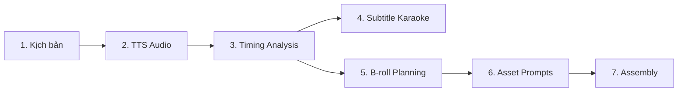
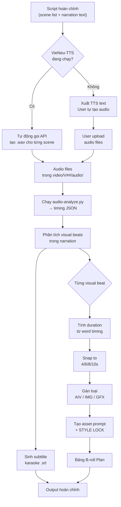

# Chuyển đổi Gem2 Video Director → Antigravity Skill (Audio-First Workflow)

## Mô tả mục tiêu

Chuyển đổi tài liệu [gem2-video-director.md](file:///c:/Users/tuanlee/Downloads/files%20(1)/faceless-gem-notebooklm/faceless-gem-notebooklm/02-gems/gem2-video-director.md) — hiện dùng để chat thủ công với Gemini Gems — thành một **Antigravity skill** hoạt động trong agent harness. Skill sẽ hỗ trợ toàn bộ quy trình sản xuất video YouTube faceless với triết lý **audio-first**: tạo narration audio trước → đo timing chính xác → từ đó quyết định subtitle karaoke và số lượng B-roll tương ứng.

Repo `audio/` sẽ chứa nhiều channel, mỗi channel có thư mục riêng với channel-bible, videos và assets.

---

## User Review Required

> [!IMPORTANT]
> **Thay đổi triết lý quy trình**: Gem2 gốc tạo TTS text *song song* với prompt asset, scene duration cố định dựa trên đếm từ. Skill mới sẽ đảo quy trình: **audio narration → word-level timing → subtitle + B-roll planning**. Điều này thay đổi fundamentally cách xác định thời lượng scene.

> [!WARNING]
> **VieNeu-TTS API integration**: Skill sẽ tự động gọi VieNeu-TTS API (localhost:8000) khi service chạy, fallback sang manual khi không có. Cần xác nhận VieNeu-TTS API có hỗ trợ **word-level timestamps** không, hoặc cần dùng thêm công cụ alignment (forced alignment với Whisper hoặc tương tự).

---

## Decisions (Resolved)

> [!TIP]
> **Word-level timing — ĐÃ CHỐT: Whisper**
> Dùng Whisper (Python `openai-whisper` hoặc `whisper.cpp`) để transcribe lại audio → lấy word-level timestamps. Lý do:
> - Chạy đa nền tảng (Windows + Ubuntu)
> - Tận dụng GPU khi có (CUDA)
> - Độ chính xác cao nhất cho timeline
> - Fallback sang CPU khi không có GPU

> [!TIP]
> **B-roll planning — ĐÃ CHỐT: Auto + Review**
> - Agent **tự động** phân tích narration content và quyết định số lượng, thời lượng B-roll dựa trên Whisper timestamps
> - Hệ thống xuất **file JSON review** (`broll-plan.json`) + hiển thị dạng timeline/table để user **REVIEW và CHỈNH SỬA** trước khi tạo asset prompts
> - Chỉ sau khi user approve broll-plan mới tiến hành Phase 4 (Asset Prompts)

---

## Proposed Changes

### Cấu trúc tổng thể

```
audio/
├── .agents/
│   └── skills/
│       └── video-director/              ← Skill chính
│           ├── SKILL.md                 ← Entry point + hướng dẫn agent
│           ├── references/
│           │   ├── camera-vocabulary.md
│           │   ├── channel-bible.template.md
│           │   ├── shot-list.template.md
│           │   └── assembly-checklist.md
│           ├── scripts/
│           │   ├── tts-generate.ps1     ← Gọi VieNeu-TTS API tạo audio
│           │   ├── audio-analyze.py     ← Phân tích timing (word-level)
│           │   └── subtitle-gen.py      ← Sinh subtitle karaoke từ timing
│           └── resources/
│               └── tts-profiles.md      ← Cấu hình TTS profiles (gemini-3.8/3.1/vieneu)
├── channels/
│   └── <channel-name>/                  ← Mỗi kênh một thư mục
│       ├── channel-bible.md
│       ├── schedule.md                  ← Lịch trình video
│       └── videos/
│           └── V01/                     ← Mỗi video một thư mục
│               ├── script.md            ← Kịch bản theo scene
│               ├── audio/
│               │   ├── S001_narration.wav
│               │   ├── S001_timing.json ← Word-level timestamps
│               │   ├── S002_narration.wav
│               │   └── S002_timing.json
│               ├── assets/
│               │   ├── V01_S001_6s_AIV_sb.png
│               │   ├── V01_S001_6s_AIV.mp4
│               │   └── V01_S002_IMG.png
│               ├── subtitles/
│               │   └── V01_karaoke.srt  ← Subtitle karaoke style
│               └── broll-plan.md        ← B-roll planning dựa trên timing
├── studio/
├── VieNeu-TTS/
└── ...
```

---

### Component 1: Skill Definition

#### [NEW] `.agents/skills/video-director/SKILL.md`

Entry point cho agent. Đây là file quan trọng nhất, chứa toàn bộ hướng dẫn quy trình.

```markdown
---
name: video-director
description: >-
  Skill tạo video YouTube faceless theo quy trình audio-first. Kích hoạt khi
  user muốn tạo video mới, quản lý lịch trình video, viết kịch bản, tạo TTS
  audio, phân tích timing, lên kế hoạch B-roll, sinh subtitle karaoke, và
  tạo prompt cho AI image/video. Hỗ trợ đa kênh (multi-channel).
---

# Video Director — Audio-First Faceless YouTube Production

## Tổng quan quy trình

Quy trình sản xuất video tuân theo triết lý **Audio-First**: giọng đọc (narration)
là trục chính, mọi thứ khác (hình ảnh, subtitle, hiệu ứng) đồng bộ theo timing
của audio.

### Pipeline



## Phase 1 — Khởi tạo & Lịch trình
(Chi tiết quy trình từ gem2 gốc, được điều chỉnh cho agent...)

## Phase 2 — Kịch bản (Script)
(Viết script theo scene, đếm từ, tuân thủ ràng buộc thời lượng...)

## Phase 3 — Audio-First Pipeline ⭐ (KHÁC BIỆT CHÍNH)

### 3.1 Tạo TTS Audio cho từng scene
- Kiểm tra VieNeu-TTS service có đang chạy không (health check localhost:8000)
- Nếu có: tự động gọi API tạo audio cho từng scene
- Nếu không: xuất TTS text để user tự tạo, chờ user cung cấp audio files

### 3.2 Phân tích Timing
- Chạy script phân tích audio → word-level timestamps
- Output: JSON file cho mỗi scene chứa {word, start_ms, end_ms}

### 3.3 Xác định B-roll dựa trên Timing
- Phân tích nội dung narration → xác định "visual beats"
- Mỗi visual beat = 1 B-roll segment
- Duration B-roll = timing giữa các beats
- Ràng buộc AIV: chỉ 4/6/8/10s → snap duration về giá trị gần nhất

### 3.4 Sinh Subtitle Karaoke
- Từ word-level timing → subtitle .srt với highlight từng từ theo nhịp nói

## Phase 4 — Asset Prompts
(Prompt ảnh/video theo STYLE LOCK, camera vocabulary...)

## Phase 5 — Assembly Checklist
(Ráp video theo thứ tự...)
```

> [!NOTE]
> Nội dung chi tiết trong SKILL.md sẽ dài hơn nhiều. Ở trên chỉ là outline cấu trúc. Nội dung đầy đủ sẽ tích hợp toàn bộ logic từ gem2-video-director.md, được tái cấu trúc cho agent thay vì chat thủ công.

---

### Component 2: Channel Data Structure

#### [NEW] `channels/` directory structure

Mỗi channel là một thư mục con:

```
channels/<channel-name>/
├── channel-bible.md          ← Copy từ output Gem1, hoặc tạo mới
├── schedule.md               ← Lịch trình video (⬜/✅)
└── videos/
    └── V01/
        ├── script.md         ← Kịch bản chuẩn hóa
        ├── audio/            ← Narration audio + timing JSON
        ├── assets/           ← AI-generated images/videos
        ├── subtitles/        ← Subtitle karaoke
        └── broll-plan.md     ← B-roll planning
```

Agent sẽ tự tạo cấu trúc này khi user nói "tạo channel mới" hoặc "tạo video mới".

---

### Component 3: Reference Files

#### [NEW] `.agents/skills/video-director/references/camera-vocabulary.md`
Copy nguyên văn từ [camera-vocabulary.md](file:///c:/Users/tuanlee/Downloads/files%20(1)/faceless-gem-notebooklm/faceless-gem-notebooklm/03-knowledge/camera-vocabulary.md).

#### [NEW] `.agents/skills/video-director/references/channel-bible.template.md`
Copy nguyên văn từ [channel-bible.template.md](file:///c:/Users/tuanlee/Downloads/files%20(1)/faceless-gem-notebooklm/faceless-gem-notebooklm/03-knowledge/channel-bible.template.md).

#### [NEW] `.agents/skills/video-director/references/shot-list.template.md`
Copy nguyên văn từ [shot-list.template.md](file:///c:/Users/tuanlee/Downloads/files%20(1)/faceless-gem-notebooklm/faceless-gem-notebooklm/03-knowledge/shot-list.template.md).

#### [NEW] `.agents/skills/video-director/references/assembly-checklist.md`
Copy nguyên văn từ [assembly-checklist.md](file:///c:/Users/tuanlee/Downloads/files%20(1)/faceless-gem-notebooklm/faceless-gem-notebooklm/03-knowledge/assembly-checklist.md).

---

### Component 4: Automation Scripts

#### [NEW] `.agents/skills/video-director/scripts/tts-generate.ps1`

Script PowerShell gọi VieNeu-TTS API:

```powershell
# Tạo audio cho 1 scene
# Usage: .\tts-generate.ps1 -Text "Lời đọc scene" -Voice "ngoc-anh" -OutputPath "audio/S001.wav"

param(
    [Parameter(Mandatory)][string]$Text,
    [string]$Voice = "ngoc-anh",
    [string]$OutputPath,
    [string]$ApiUrl = "http://localhost:8000",
    [string]$Style = ""  # Cho gemini-3.8 style profile
)

# Health check
try {
    $health = Invoke-RestMethod "$ApiUrl/health" -TimeoutSec 5
} catch {
    Write-Error "VieNeu-TTS không chạy tại $ApiUrl. Hãy chạy 'launcher.ps1 start' trước."
    exit 1
}

# Gọi API
$body = @{
    model = "vieneu-tts-v3-turbo"
    input = $Text
    voice = $Voice
    response_format = "wav"
} | ConvertTo-Json

$response = Invoke-WebRequest -Uri "$ApiUrl/v1/audio/speech" `
    -Method POST -Body $body -ContentType "application/json" -TimeoutSec 120

[System.IO.File]::WriteAllBytes($OutputPath, $response.Content)
Write-Host "Audio saved: $OutputPath"
```

#### [NEW] `.agents/skills/video-director/scripts/audio-analyze.py`

Script Python phân tích audio timing (dùng Whisper hoặc tương tự):

```python
"""
Phân tích audio narration → word-level timestamps.
Usage: python audio-analyze.py <audio_file> <output_json>

Output JSON format:
{
  "duration_ms": 6320,
  "words": [
    {"word": "Mười", "start_ms": 120, "end_ms": 450},
    {"word": "lăm", "start_ms": 460, "end_ms": 680},
    ...
  ]
}
"""
import sys
import json

def analyze_with_whisper(audio_path: str) -> dict:
    """Dùng Whisper để transcribe + lấy word timestamps."""
    try:
        import whisper
        model = whisper.load_model("base")
        result = model.transcribe(audio_path, word_timestamps=True)
        words = []
        for segment in result["segments"]:
            for w in segment.get("words", []):
                words.append({
                    "word": w["word"].strip(),
                    "start_ms": int(w["start"] * 1000),
                    "end_ms": int(w["end"] * 1000),
                })
        # Lấy duration từ file
        import wave
        with wave.open(audio_path, 'r') as wf:
            duration_ms = int(wf.getnframes() / wf.getframerate() * 1000)
        return {"duration_ms": duration_ms, "words": words}
    except ImportError:
        return estimate_timing(audio_path)

def estimate_timing(audio_path: str) -> dict:
    """Fallback: ước lượng timing dựa trên PACE khi không có Whisper."""
    import wave
    with wave.open(audio_path, 'r') as wf:
        duration_ms = int(wf.getnframes() / wf.getframerate() * 1000)
    return {"duration_ms": duration_ms, "words": [], "note": "Install whisper for word-level timing"}

if __name__ == "__main__":
    audio_file = sys.argv[1]
    output_json = sys.argv[2]
    result = analyze_with_whisper(audio_file)
    with open(output_json, 'w', encoding='utf-8') as f:
        json.dump(result, f, ensure_ascii=False, indent=2)
    print(f"Timing saved: {output_json} ({result['duration_ms']}ms, {len(result['words'])} words)")
```

#### [NEW] `.agents/skills/video-director/scripts/subtitle-gen.py`

Script sinh subtitle karaoke từ timing data:

```python
"""
Sinh subtitle karaoke-style từ timing JSON.
Usage: python subtitle-gen.py <timing_dir> <output_srt>

Karaoke style: hiển thị nhóm 3-5 từ, highlight từ đang đọc.
"""
import sys
import json
import os
from pathlib import Path

def timing_to_karaoke_srt(timing_dir: str, output_srt: str):
    timing_files = sorted(Path(timing_dir).glob("*_timing.json"))
    srt_entries = []
    index = 1
    offset_ms = 0  # Offset tích lũy qua các scene

    for tf in timing_files:
        with open(tf, 'r', encoding='utf-8') as f:
            data = json.load(f)

        words = data.get("words", [])
        if not words:
            offset_ms += data.get("duration_ms", 0)
            continue

        # Nhóm từ (3-5 từ mỗi subtitle entry)
        group_size = 4
        for i in range(0, len(words), group_size):
            group = words[i:i + group_size]
            start = format_time(group[0]["start_ms"] + offset_ms)
            end = format_time(group[-1]["end_ms"] + offset_ms)
            text = " ".join(w["word"] for w in group)

            srt_entries.append(f"{index}\n{start} --> {end}\n{text}\n")
            index += 1

        offset_ms += data.get("duration_ms", 0)

    with open(output_srt, 'w', encoding='utf-8') as f:
        f.write("\n".join(srt_entries))
    print(f"Subtitle saved: {output_srt} ({index - 1} entries)")

def format_time(ms: int) -> str:
    h = ms // 3600000
    m = (ms % 3600000) // 60000
    s = (ms % 60000) // 1000
    ms_r = ms % 1000
    return f"{h:02d}:{m:02d}:{s:02d},{ms_r:03d}"

if __name__ == "__main__":
    timing_to_karaoke_srt(sys.argv[1], sys.argv[2])
```

---

### Component 5: TTS Profiles Resource

#### [NEW] `.agents/skills/video-director/resources/tts-profiles.md`

```markdown
# TTS Profiles

Cấu hình cho 3 engine TTS được hỗ trợ. Agent chọn profile dựa trên
CẤU HÌNH trong schedule.md của channel.

## gemini-3.8 (Mặc định)
- Không dùng tag ngoặc vuông
- Tag góc nhọn: <short pause> <long pause> <sigh> <laugh> <breath> <gasp>
- Cảm xúc/giọng điều khiển bằng STYLE (tiếng Anh, ≤ 8 từ)
- Chia khối TTS theo style, gom ít khối nhất

## gemini-3.1
- Tag ngoặc vuông tiếng Anh
- Cảm xúc: [neutral] [calm] [curious] [serious] [tension] [hope]
  [frustration] [amusement] [awe] [excited]
- Nhịp: [slow] [fast]
- Khoảng lặng: [short pause] [medium pause] [long pause]

## vieneu (VieNeu-TTS)
- 3 tag: [cười] [thở dài] [hắng giọng]
- Cảm xúc bằng câu ngắn, dấu phẩy, "...", "—"
- Mỗi câu ≤ 256 ký tự
- Gọi qua API localhost:8000
```

---

### Component 6: SKILL.md Chi tiết — Audio-First Pipeline

Phần quan trọng nhất trong SKILL.md là hướng dẫn agent thực hiện **Phase 3 (Audio-First)**. Dưới đây là logic chi tiết:

#### Luồng xử lý Audio-First



#### So sánh Gem2 gốc vs Skill mới

| Khía cạnh | Gem2 gốc | Skill mới (Audio-First) |
|---|---|---|
| Xác định duration scene | Đếm từ × PACE → ước lượng | TTS audio → đo thực tế |
| Số B-roll per scene | 1 scene = 1 asset (cố định) | 1 scene narration → N visual beats → N B-rolls |
| Subtitle | Không tạo tự động | Tự sinh karaoke .srt từ word timing |
| TTS | Xuất text, user tự tạo | Auto nếu có VieNeu-TTS, fallback manual |
| Quản lý file | Không | Cấu trúc thư mục chuẩn per-channel/per-video |
| Quy trình | Chat tuần tự | Agent-driven pipeline với scripts |

#### Logic xác định số B-roll cho 1 scene narration

```
Scene narration: "Năm 1969, con người lần đầu đặt chân lên Mặt Trăng.
                  Neil Armstrong bước ra khỏi tàu, nói câu nói nổi tiếng.
                  Hàng triệu người trên Trái Đất theo dõi qua truyền hình."

→ Visual beats phân tích:
  Beat 1: "Năm 1969... Mặt Trăng" → Cảnh tên lửa phóng / Mặt Trăng (6s AIV)
  Beat 2: "Neil Armstrong bước ra... nổi tiếng" → Phi hành gia bước xuống (4s AIV)
  Beat 3: "Hàng triệu người... truyền hình" → Đám đông xem TV (4s AIV)

→ Thay vì 1 clip 14s (không hợp lệ AIV), ta có 3 B-rolls tổng 14s
→ Mỗi B-roll duration snap vào {4,6,8,10}s dựa trên word timing thực tế
```

---

### Component 7: Agent Commands & Interaction

Skill sẽ hỗ trợ các lệnh tương tự gem2 gốc nhưng thông qua agent:

| Lệnh user | Agent action |
|---|---|
| `tạo channel <tên>` | Tạo cấu trúc thư mục `channels/<tên>/` |
| `bắt đầu video mới` | Khởi tạo `V##/`, bắt đầu Phase 1 |
| `tiếp` | Tiếp tục phase/batch tiếp theo |
| `sửa cảnh N: ...` | Sửa scene N trong script, re-gen audio nếu cần |
| `sửa style: ...` | Cập nhật STYLE LOCK |
| `tạo audio` | Trigger Phase 3 (TTS + timing) |
| `xem timing` | Hiển thị timing analysis |
| `xem broll plan` | Hiển thị B-roll planning |
| `xuất subtitle` | Sinh file .srt karaoke |

---

## Verification Plan

### Automated Tests

```powershell
# 1. Kiểm tra cấu trúc skill hợp lệ
Test-Path "c:\Users\tuanlee\Downloads\audio\.agents\skills\video-director\SKILL.md"

# 2. Kiểm tra scripts chạy được
python "c:\Users\tuanlee\Downloads\audio\.agents\skills\video-director\scripts\audio-analyze.py" --help
python "c:\Users\tuanlee\Downloads\audio\.agents\skills\video-director\scripts\subtitle-gen.py" --help

# 3. Kiểm tra reference files tồn tại
Get-ChildItem "c:\Users\tuanlee\Downloads\audio\.agents\skills\video-director\references\"

# 4. Test tạo channel structure
# (Agent tự tạo khi user gõ "tạo channel test-channel")
Test-Path "c:\Users\tuanlee\Downloads\audio\channels\"
```

### Manual Verification

1. **Skill discovery**: Mở Antigravity trong workspace `audio/`, kiểm tra skill `video-director` xuất hiện trong danh sách skills
2. **Channel creation**: Gõ "tạo channel test-channel" → kiểm tra thư mục được tạo đúng cấu trúc
3. **TTS integration**: Nếu VieNeu-TTS đang chạy, test auto-generate audio cho 1 scene ngắn
4. **Timing analysis**: Cung cấp file audio mẫu, kiểm tra output timing JSON
5. **Subtitle generation**: Từ timing JSON, kiểm tra file .srt output
6. **End-to-end**: Chạy thử toàn bộ quy trình cho 1 video 3-scene ngắn

---

## Danh sách file sẽ tạo

| # | File | Mô tả |
|---|---|---|
| 1 | `.agents/skills/video-director/SKILL.md` | Entry point skill — toàn bộ hướng dẫn quy trình |
| 2 | `.agents/skills/video-director/references/camera-vocabulary.md` | Camera vocabulary reference |
| 3 | `.agents/skills/video-director/references/channel-bible.template.md` | Channel Bible template |
| 4 | `.agents/skills/video-director/references/shot-list.template.md` | Shot list template |
| 5 | `.agents/skills/video-director/references/assembly-checklist.md` | Assembly checklist |
| 6 | `.agents/skills/video-director/scripts/tts-generate.ps1` | TTS API caller script |
| 7 | `.agents/skills/video-director/scripts/audio-analyze.py` | Audio timing analyzer |
| 8 | `.agents/skills/video-director/scripts/subtitle-gen.py` | Subtitle karaoke generator |
| 9 | `.agents/skills/video-director/resources/tts-profiles.md` | TTS engine profiles |
| 10 | `channels/.gitkeep` | Placeholder cho channels directory |
